 <p align="center">
  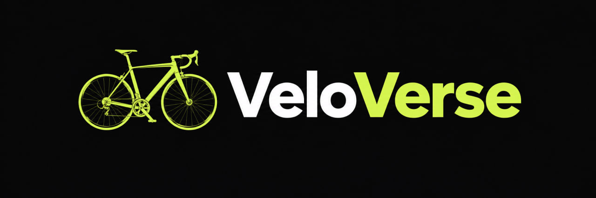
</p>

# VeloVerse

### Explore. Understand. Compare.

VeloVerse is an interactive bicycle education platform designed to help beginners and cycling enthusiasts learn about bicycles, explore their components and materials, discover different models, and compare bicycles side by side.

## Features

- Nine bicycle types with educational information
- Interactive bicycle anatomy diagram
- Detailed bicycle component explanations
- Bicycle materials and their characteristics
- Bicycle brands and models
- Search and filtering
- Side-by-side bicycle comparison
- Responsive dark-themed interface

## Website Screenshots

### Homepage

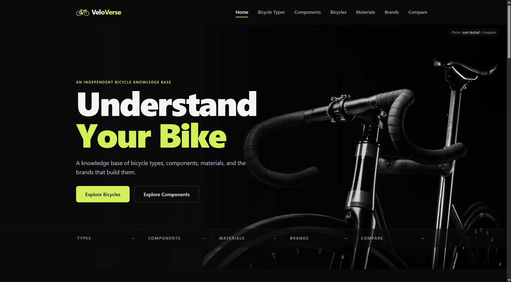

### Bicycle Types

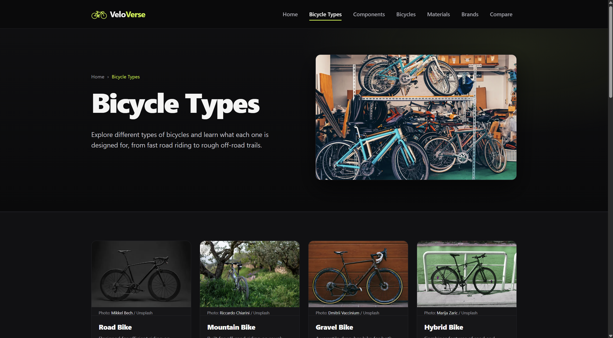

### Interactive Bicycle Anatomy

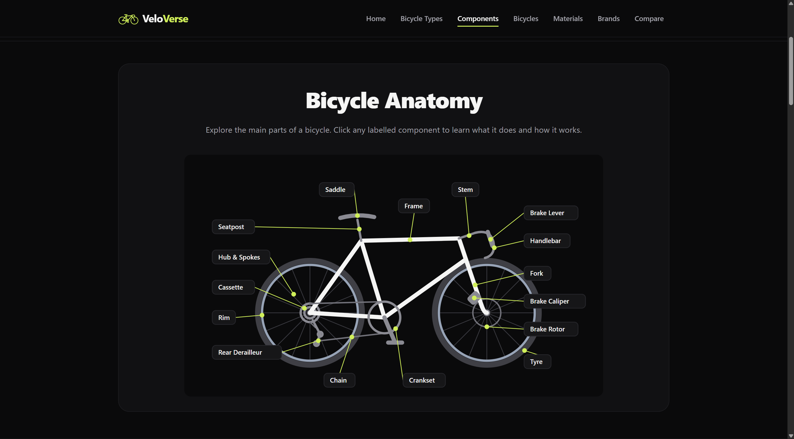

### Bicycle Components

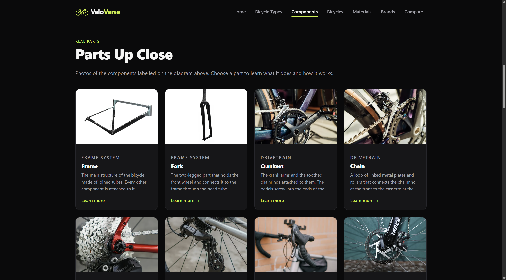

### Bicycle Materials

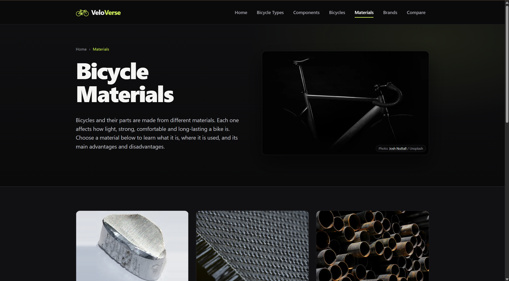

### Bicycle Brands

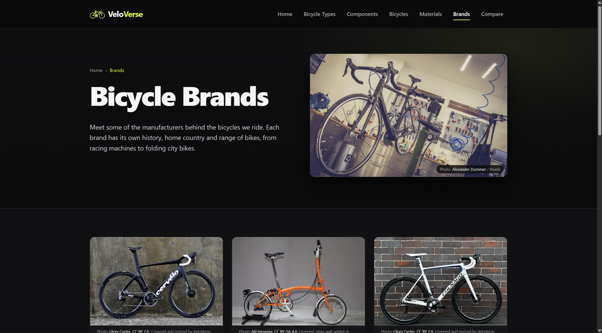

### Bicycle Comparison

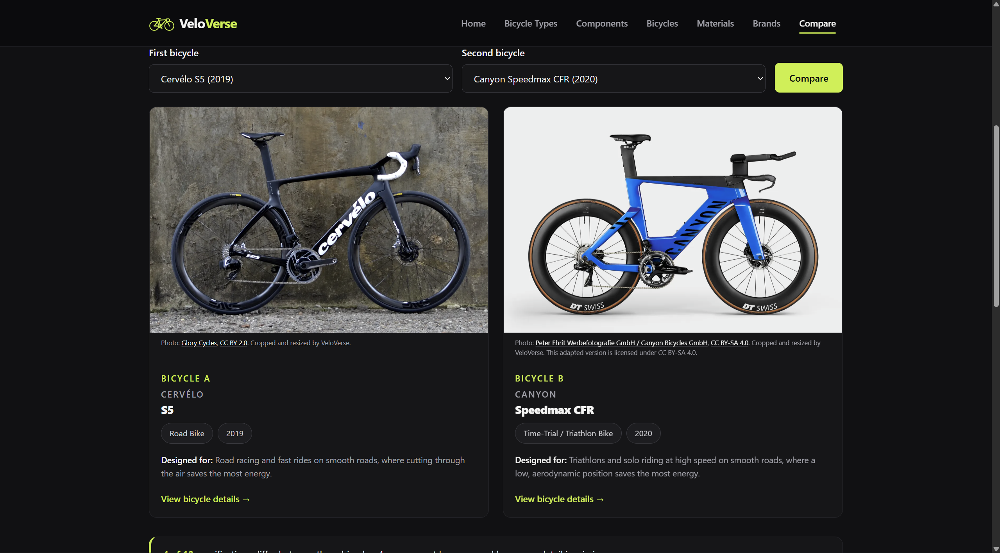

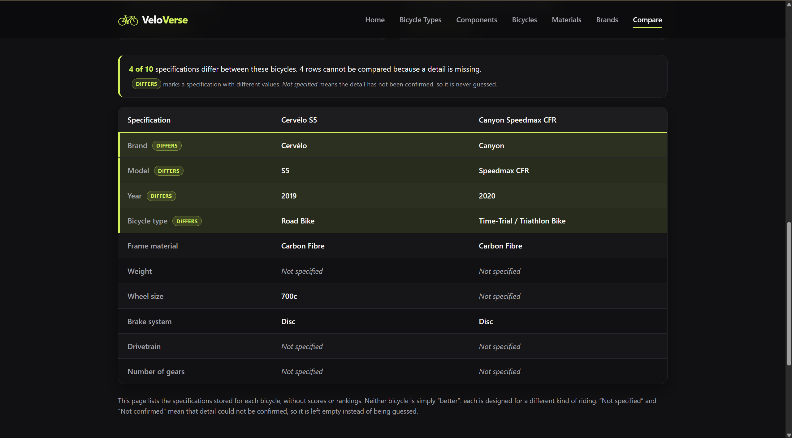

### Bicycle Details

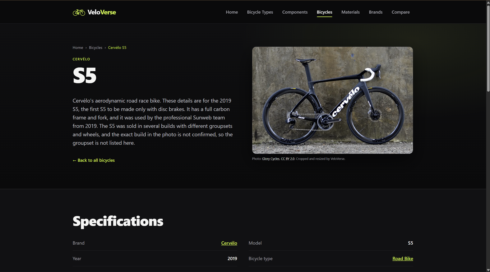

## Technology Stack

| Category | Technologies |
|---|---|
| Backend | Java 21, Spring Boot |
| Frontend | HTML, CSS, JavaScript, Thymeleaf |
| Database | PostgreSQL |
| Data Access | Spring Data JPA |
| Build Tool | Maven |
| Testing | JUnit, Maven |
| Version Control | Git and GitHub |

## System Architecture

VeloVerse follows a layered web application architecture.

- **Presentation Layer:** HTML, CSS and JavaScript provide the user interface.
- **Controller Layer:** Spring MVC controllers handle incoming HTTP requests.
- **Service Layer:** Java services manage application logic and retrieve the information needed by the website.
- **Repository Layer:** Spring Data JPA repositories provide access to the database.
- **Database Layer:** PostgreSQL stores bicycle types, components, materials, brands and bicycle models.
- **Template Rendering:** Thymeleaf renders server-side HTML pages using data provided by the controllers.

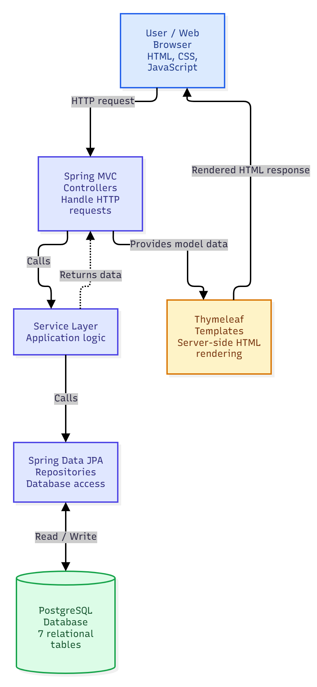

## Database Design

VeloVerse uses a PostgreSQL relational database containing seven tables:

1. `bicycle_types`
2. `materials`
3. `component_systems`
4. `components`
5. `component_materials`
6. `brands`
7. `bicycles`

The database uses primary keys and foreign keys to connect related information. The `component_materials` table supports a many-to-many relationship between bicycle components and materials.

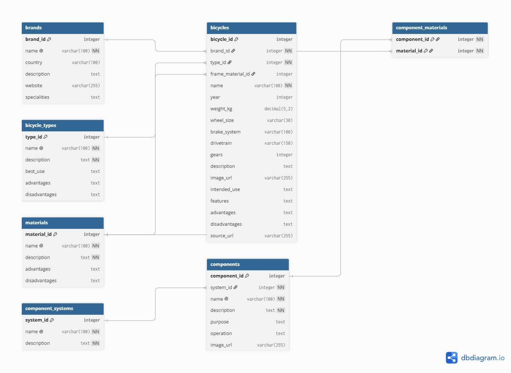

For a detailed explanation, see the [Database Design Documentation](docs/database-design.md).

## Testing

The project includes automated tests covering application functionality.

Latest completed local test run:

- **97 tests executed**
- **97 passed**
- **0 failures**
- **0 errors**
- **0 skipped**

To run the tests on Windows:

```powershell
.\mvnw.cmd test
```

## Installation and Setup

### Prerequisites

Before running VeloVerse, install:

- Java 21
- PostgreSQL
- Git

The project includes a Maven Wrapper, so a separate Maven installation is not required.

### 1. Clone the Repository

```bash
git clone https://github.com/NikolaTW7/veloverse.git
cd veloverse
```

### 2. Configure the Database

Create a PostgreSQL database named `veloverse`.

The default local connection settings are:

| Setting | Value |
|---|---|
| Host | `localhost` |
| Port | `5432` |
| Database | `veloverse` |
| Username | `postgres` |
| Password | Provided through the `DB_PASSWORD` environment variable |

The application reads the database password from an environment variable rather than storing it directly in `application.properties`.

For Windows PowerShell, set the environment variable:

```powershell
$env:DB_PASSWORD = "YOUR_LOCAL_PASSWORD"
```

Replace `YOUR_LOCAL_PASSWORD` with your own PostgreSQL password. Do not commit real passwords or other credentials to GitHub.

The application uses `schema.sql` to create the required database tables and `data.sql` to initialise starter data.

### 3. Run the Application

On Windows, open a terminal in the project folder and run:

```powershell
.\mvnw.cmd spring-boot:run
```

### 4. Open the Website

Once the application starts successfully, open:

http://localhost:8080

**Note:** This is a local development address. It does not represent a publicly deployed website.

## Project Documentation

The following documents describe VeloVerse's final design and implementation:

- [System Architecture Diagram](docs/VeloVerse_System_Architecture.png)
- [Entity Relationship (ER) Diagram](docs/VeloVerse_ER_Diagram.png)
- [Database Design Documentation](docs/database-design.md)
- [Final Project Documentation (PDF)](docs/VeloVerse_Final_Project_Documentation.pdf)
- [Final Project Documentation (Word)](docs/VeloVerse_Final_Project_Documentation.docx)
- [Editable System Architecture Diagram](docs/VeloVerse_System_Architecture.drawio)
- [Image Credits](IMAGE-CREDITS.md)
- [Data Sources](DATA-SOURCES.md)

## Project Status

VeloVerse's core educational and bicycle comparison features have been implemented.

The source code, automated tests, database schema, documentation and screenshots are available in this GitHub repository.

Public website deployment and further improvements are planned.

## Future Improvements

Possible future developments include:

- Interactive 3D bicycle models
- Additional bicycle brands and models
- Expanded educational content
- Improvements to search and filtering
- Public deployment and hosting

## Author

Developed as a personal software engineering and web development project.

**GitHub:** [NikolaTW7](https://github.com/NikolaTW7)

