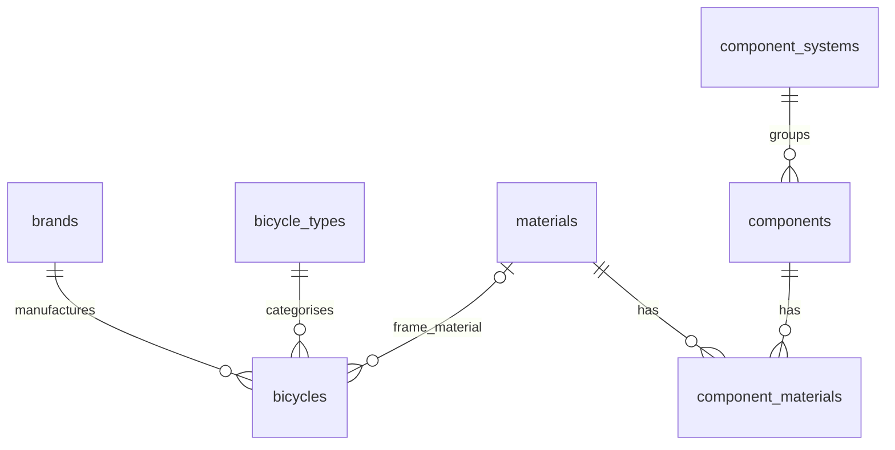

# VeloVerse Database Design

## 1. Purpose and source of truth

VeloVerse is an educational bicycle website developed as a final portfolio project. Its database stores information about bicycle types, materials, component systems, individual components, brands and bicycle models. This information supports learning about bicycles and comparing models using consistent specifications.

This document follows the complete PostgreSQL `schema.sql` pasted by the user in the project conversation. It describes the final structure after both the `CREATE TABLE` and `ALTER TABLE` statements have run. The schema is authoritative where an earlier diagram or description differs.

The database contains **seven tables, 47 fields and six foreign-key relationships**. This document explains what the schema supports; it does not claim that particular pages, queries or application behaviours have been verified in source code. The complete `data.sql` and application configuration were not supplied alongside the authoritative schema, so initialization details below distinguish the schema's stated setup from unverified implementation details.

## 2. Design overview

| Table | Purpose |
| --- | --- |
| `bicycle_types` | Explains categories such as road bikes and mountain bikes. |
| `materials` | Stores information about materials used for frames and components. |
| `component_systems` | Groups components into systems such as drivetrain and braking. |
| `components` | Describes individual parts, their purpose and their operation. |
| `component_materials` | Links components to the materials they can use. |
| `brands` | Stores bicycle manufacturer information. |
| `bicycles` | Stores bicycle models, specifications and educational descriptions. |

Separate reference tables avoid repeating full brand, type, system and material descriptions in every related record. Foreign keys connect these records. The join table `component_materials` represents a many-to-many relationship without storing a list of material IDs inside a component record.

### Reading the field definitions

- **PK (primary key):** uniquely identifies a row and cannot be `NULL`.
- **FK (foreign key):** references an existing row in another table whenever a value is supplied.
- **UNIQUE:** prevents duplicate values or duplicate combinations, subject to PostgreSQL's treatment of `NULL` explained below.
- **NOT NULL:** requires a value. It does not by itself reject an empty string.
- **Optional:** the column accepts `NULL`, meaning the value can be absent or unknown.
- **Identity:** the six single-column primary keys use exactly `INTEGER GENERATED BY DEFAULT AS IDENTITY PRIMARY KEY`. PostgreSQL generates an ID when one is omitted, but `BY DEFAULT` also permits explicit IDs.

`VARCHAR(n)` limits text to `n` characters. `TEXT` has no declared character-length limit. `NUMERIC(5,2)` stores an exact number with five total digits, including two decimal places. No application-data defaults or `CHECK` constraints are declared in this schema.

## 3. Table definitions

### 3.1 `bicycle_types`

Stores general bicycle categories and their educational explanations. The schema comments specify one point per line for `advantages` and `disadvantages`.

| Field | Exact SQL type | Required? | Keys and constraints | Meaning |
| --- | --- | --- | --- | --- |
| `type_id` | `INTEGER` | Yes, through PK | PK; `GENERATED BY DEFAULT AS IDENTITY` | Bicycle type identifier. |
| `name` | `VARCHAR(100)` | Yes | `NOT NULL`, `UNIQUE` | Category name. |
| `description` | `TEXT` | Yes | `NOT NULL` | Explanation of the category. |
| `best_use` | `TEXT` | No | Optional | Suitable riding conditions or activities. |
| `advantages` | `TEXT` | No | Optional | Benefits of the type. |
| `disadvantages` | `TEXT` | No | Optional | Drawbacks of the type. |

### 3.2 `materials`

Stores shared material information, such as aluminium, carbon fibre and steel. The same material can be referenced by bicycle frames and by multiple components.

| Field | Exact SQL type | Required? | Keys and constraints | Meaning |
| --- | --- | --- | --- | --- |
| `material_id` | `INTEGER` | Yes, through PK | PK; `GENERATED BY DEFAULT AS IDENTITY` | Material identifier. |
| `name` | `VARCHAR(100)` | Yes | `NOT NULL`, `UNIQUE` | Material name. |
| `description` | `TEXT` | Yes | `NOT NULL` | Explanation of the material. |
| `advantages` | `TEXT` | No | Optional | Material benefits. |
| `disadvantages` | `TEXT` | No | Optional | Material drawbacks. |

### 3.3 `component_systems`

Stores groups of related bicycle parts. Each component belongs to one system.

| Field | Exact SQL type | Required? | Keys and constraints | Meaning |
| --- | --- | --- | --- | --- |
| `system_id` | `INTEGER` | Yes, through PK | PK; `GENERATED BY DEFAULT AS IDENTITY` | Component system identifier. |
| `name` | `VARCHAR(100)` | Yes | `NOT NULL`, `UNIQUE` | System name. |
| `description` | `TEXT` | Yes | `NOT NULL` | Explanation of the system. |

### 3.4 `components`

Stores individual parts, such as a frame, chain or brake lever, with information about their role and operation.

| Field | Exact SQL type | Required? | Keys and constraints | Meaning |
| --- | --- | --- | --- | --- |
| `component_id` | `INTEGER` | Yes, through PK | PK; `GENERATED BY DEFAULT AS IDENTITY` | Component identifier. |
| `system_id` | `INTEGER` | Yes | `NOT NULL`; FK → `component_systems(system_id)` | System containing this component. |
| `name` | `VARCHAR(100)` | Yes | `NOT NULL`, `UNIQUE` | Component name, unique across the entire table. |
| `description` | `TEXT` | Yes | `NOT NULL` | General explanation of the part. |
| `purpose` | `TEXT` | No | Optional | What the part is used for. |
| `operation` | `TEXT` | No | Optional | How the part works. |
| `image_url` | `VARCHAR(255)` | No | Optional | Image reference stored as text. |

### 3.5 `component_materials`

This join table stores one component–material association per row. It has no separate identity column.

| Field | Exact SQL type | Required? | Keys and constraints | Meaning |
| --- | --- | --- | --- | --- |
| `component_id` | `INTEGER` | Yes | `NOT NULL`; part of composite PK; FK → `components(component_id)` | Associated component. |
| `material_id` | `INTEGER` | Yes | `NOT NULL`; part of composite PK; FK → `materials(material_id)` | Associated material. |

The exact composite key is:

```sql
PRIMARY KEY (component_id, material_id)
```

The **pair** must be unique. Either ID can appear in several rows as long as its partner differs. For example, one component can link to both steel and aluminium, while steel can link to several components. Neither column is individually `UNIQUE`.

### 3.6 `brands`

Stores bicycle manufacturers. `website` and `specialities` are part of the final table because the schema adds them with `ALTER TABLE`.

| Field | Exact SQL type | Required? | Keys and constraints | Meaning |
| --- | --- | --- | --- | --- |
| `brand_id` | `INTEGER` | Yes, through PK | PK; `GENERATED BY DEFAULT AS IDENTITY` | Brand identifier. |
| `name` | `VARCHAR(100)` | Yes | `NOT NULL`, `UNIQUE` | Manufacturer name. |
| `country` | `VARCHAR(100)` | No | Optional | Manufacturer's country. |
| `description` | `TEXT` | No | Optional | Brand background. |
| `website` | `VARCHAR(255)` | No | Optional; added by `ALTER TABLE` | Brand website reference. |
| `specialities` | `TEXT` | No | Optional; added by `ALTER TABLE` | Areas in which the brand specialises. |

### 3.7 `bicycles`

Stores bicycle models. Each model must reference one brand and one bicycle type. Its frame material may be unknown. The five additional descriptive fields are included in the final table through `ALTER TABLE` statements.

| Field | Exact SQL type | Required? | Keys and constraints | Meaning |
| --- | --- | --- | --- | --- |
| `bicycle_id` | `INTEGER` | Yes, through PK | PK; `GENERATED BY DEFAULT AS IDENTITY` | Bicycle model record identifier. |
| `brand_id` | `INTEGER` | Yes | `NOT NULL`; FK → `brands(brand_id)`; part of composite UNIQUE | Model's manufacturer. |
| `type_id` | `INTEGER` | Yes | `NOT NULL`; FK → `bicycle_types(type_id)` | Model's bicycle category. |
| `frame_material_id` | `INTEGER` | No | Optional FK → `materials(material_id)` | Frame material; `NULL` means unconfirmed. |
| `name` | `VARCHAR(100)` | Yes | `NOT NULL`; part of composite UNIQUE | Model name; not individually unique. |
| `year` | `INTEGER` | No | Optional; part of composite UNIQUE | Model year. |
| `weight_kg` | `NUMERIC(5,2)` | No | Optional | Weight in kilograms. |
| `wheel_size` | `VARCHAR(30)` | No | Optional | Wheel size expressed as text. |
| `brake_system` | `VARCHAR(100)` | No | Optional | Brake system description. |
| `drivetrain` | `VARCHAR(150)` | No | Optional | Drivetrain description. |
| `gears` | `INTEGER` | No | Optional | Number of gears. |
| `description` | `TEXT` | No | Optional | Model overview. |
| `image_url` | `VARCHAR(255)` | No | Optional | Model image reference. |
| `intended_use` | `TEXT` | No | Optional; added by `ALTER TABLE` | Intended riding activities or conditions. |
| `features` | `TEXT` | No | Optional; added by `ALTER TABLE` | Features, one item per line. |
| `advantages` | `TEXT` | No | Optional; added by `ALTER TABLE` | Benefits, one item per line. |
| `disadvantages` | `TEXT` | No | Optional; added by `ALTER TABLE` | Drawbacks, one item per line. |
| `source_url` | `VARCHAR(255)` | No | Optional; added by `ALTER TABLE` | Web page from which the model facts were obtained. |

The exact composite uniqueness rule is:

```sql
UNIQUE (brand_id, name, year)
```

When `year` is supplied, the same brand cannot have two records with the same model name and year. The same name can appear under another brand or in another year. This is a unique constraint, not the primary key; `bicycle_id` remains the primary key.

**Nullable-year limitation:** PostgreSQL's default unique constraint treats `NULL` values as distinct. Therefore, multiple records with the same `brand_id` and `name` and a `NULL` year are permitted. The schema does not use `NULLS NOT DISTINCT` or an additional rule to prevent this.

### 3.8 Unique indexes

PostgreSQL automatically creates a unique index to enforce each primary key and each `UNIQUE` constraint. This includes the composite primary key on `component_materials` and the composite unique index backing `UNIQUE (brand_id, name, year)` on `bicycles`.

The supplied schema contains **no separate `CREATE UNIQUE INDEX` statement** and does not explicitly name these indexes. The composite bicycle index is a consequence of the declared constraint. Foreign keys do not themselves automatically create indexes on their referencing columns in PostgreSQL.

## 4. The six relationships

| # | Parent → child | Foreign key in the child | Cardinality and optionality |
| --- | --- | --- | --- |
| 1 | `brands` → `bicycles` | `bicycles.brand_id` → `brands.brand_id` | A brand can have zero or many bicycles. Each bicycle requires exactly one brand. |
| 2 | `bicycle_types` → `bicycles` | `bicycles.type_id` → `bicycle_types.type_id` | A type can have zero or many bicycles. Each bicycle requires exactly one type. |
| 3 | `materials` → `bicycles` | `bicycles.frame_material_id` → `materials.material_id` | A material can be used by zero or many bicycle frames. Each bicycle references zero or one frame material. |
| 4 | `component_systems` → `components` | `components.system_id` → `component_systems.system_id` | A system can have zero or many components. Each component requires exactly one system. |
| 5 | `components` → `component_materials` | `component_materials.component_id` → `components.component_id` | A component can have zero or many material links. Each link requires exactly one component. |
| 6 | `materials` → `component_materials` | `component_materials.material_id` → `materials.material_id` | A material can have zero or many component links. Each link requires exactly one material. |

Relationships 5 and 6 together implement the many-to-many association between components and materials. This is a conceptual association built from two foreign keys, not a seventh foreign key.



All six foreign keys use `REFERENCES` without explicit `ON DELETE` or `ON UPDATE` clauses. PostgreSQL therefore uses its default `NO ACTION` behaviour. The schema does not cascade parent deletions or automatically set foreign keys to `NULL`; dependent references must be handled before an operation would leave invalid links.

## 5. Database initialization

The comments in the supplied schema describe Spring Boot initialization with `spring.sql.init.mode=always` in `application.properties`. Under that stated setup, Spring Boot runs `schema.sql` on startup and then runs `data.sql` to supply starter content.

1. **Create the structure.** `schema.sql` creates tables in dependency order: `bicycle_types`, `materials`, `component_systems`, `components`, `component_materials`, `brands`, then `bicycles`.
2. **Apply the included structural updates.** `ALTER TABLE ... ADD COLUMN IF NOT EXISTS` adds `brands.website`, `brands.specialities`, and the five additional bicycle fields: `intended_use`, `features`, `advantages`, `disadvantages`, and `source_url`.
3. **Allow unknown frame materials.** `ALTER TABLE bicycles ALTER COLUMN frame_material_id DROP NOT NULL` removes the older mandatory-material rule if it exists. This leaves the foreign key in place: a supplied material ID must still be valid.
4. **Populate starter content.** `data.sql` runs after the structure exists. Parent rows must be available before dependent rows are inserted; component–material links require both referenced records.

`CREATE TABLE IF NOT EXISTS` preserves existing tables and their rows. It does not update the definition of a table that already exists. The explicit `ALTER TABLE` statements are therefore important for databases created before the additional columns and optional frame material were introduced.

The schema comments say that `data.sql` relies on uniqueness rules for `ON CONFLICT DO NOTHING`. That approach can skip inserts which conflict with an applicable primary key or unique constraint. It does not update existing content, ignore foreign-key errors, or guarantee that every possible duplicate is rejected. In particular, a repeated bicycle record with a `NULL` year may not conflict with the composite unique constraint.

The actual seed rows, conflict targets, insert order and full repeat-run behaviour of `data.sql` cannot be confirmed from `schema.sql` alone. No seed record counts are assumed here. Identity columns allow explicit IDs for restoration, as noted in the schema comments; after restoring explicit IDs, identity sequence values may require attention to avoid future collisions.

## 6. Connection to the educational site

| Site feature | Supporting data | How the design helps |
| --- | --- | --- |
| Learning about bicycle types | `bicycle_types` | Provides category descriptions, best uses, advantages and disadvantages. |
| Learning about materials | `materials` | Provides shared explanations of material properties and trade-offs. |
| Exploring bicycle systems and parts | `component_systems`, `components` | Groups parts by system and explains each part's description, purpose and operation. |
| Understanding component materials | `component_materials`, `components`, `materials` | Shows which materials are associated with each component and allows reuse of material explanations. |
| Exploring manufacturers | `brands` | Supplies brand background, country, website and specialities. |
| Browsing bicycle models | `bicycles`, `brands`, `bicycle_types`, `materials` | Combines model details with readable brand, category and frame-material names. |
| Comparing bicycle models | `bicycles` and its three reference tables | Provides a common set of specifications and descriptive fields for comparison. |

### Bicycle comparison

A comparison can retrieve selected `bicycle_id` values and show their brand, name, year, type, frame material, weight, wheel size, brakes, drivetrain and gears side by side. Intended use, features, advantages and disadvantages add educational context, while `source_url` can identify the supporting model-information page.

Brand and type are mandatory links, so they can be retrieved with inner joins. Frame material is optional, so a **left join** to `materials` preserves bicycles whose material is unconfirmed. Missing specifications should be displayed as “Not provided” or “Not confirmed”, rather than interpreted as zero or an empty fact.

There is no comparison table in this schema. Comparing selected models can be performed by the application using existing bicycle records. The schema does not store saved comparisons, user selections, comparison limits or rankings. It also does not link a particular bicycle to individual component records: the `brake_system` and `drivetrain` fields are text descriptions, not foreign keys to `components` or `component_systems`.

## 7. Limitations and scope

- **Educational catalogue scope.** There are no tables for user accounts, authentication, orders, payments, stock, reviews, favourites or saved comparisons.
- **Limited model validation.** There are no `CHECK` constraints for positive weight, positive gear counts or a reasonable model year. `NUMERIC(5,2)` controls weight precision, not whether a value is physically realistic.
- **Optional information.** Many specifications and descriptions can be absent. Each bicycle has at most one recorded frame material; mixed-material frames are not modelled as multiple structured links.
- **Nullable model year.** The composite unique constraint does not prevent repeated brand/name combinations when `year` is `NULL`.
- **Text-based details.** Wheel sizes, brakes, drivetrains and brand specialities are free text. Features and several advantage/disadvantage fields hold line-separated content, making display straightforward but structured filtering and item-level editing less precise.
- **Global component names.** `components.name` is unique across all systems. The schema cannot store the same component name in two systems as separate records without changing that naming or constraint design.
- **No bicycle component inventory.** The component learning catalogue is not a bill of materials for each bicycle. There is no bicycle–component join table or model-specific component quantity.
- **Limited source tracking.** Each bicycle has one optional `source_url`, with no separate source table, verification date or history of specification changes. Image and website fields store text references, not files, and the schema does not validate whether those references work.
- **No audit history.** There are no creation timestamps, update timestamps, editor records or revision tables.
- **Startup changes are limited.** Re-running this schema applies only the changes explicitly included. It does not reconcile every possible older table definition, and it is not a versioned migration history.
- **Deletion and performance need application care.** Foreign keys prevent invalid references but provide no cascading cleanup. The schema declares no additional query-specific indexes; performance decisions would require actual queries and data volumes.

These boundaries should be reflected consistently in the portfolio documentation and ER diagram. Features beyond this schema should be described as possible future improvements unless separately demonstrated by the final application.
